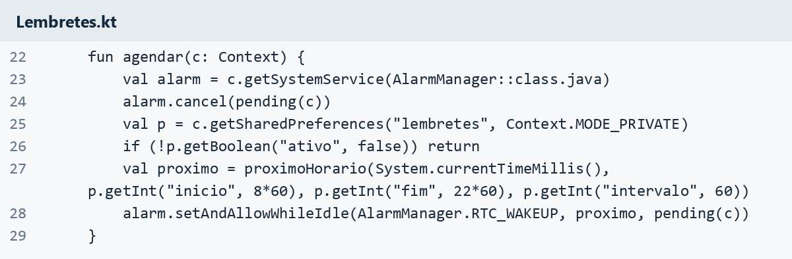
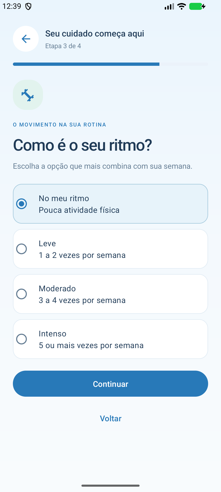
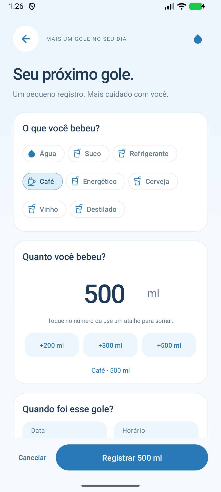
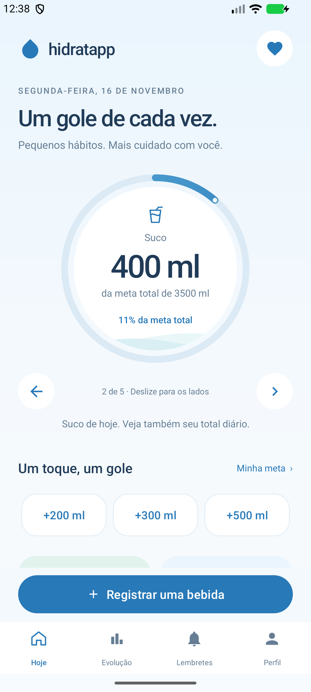
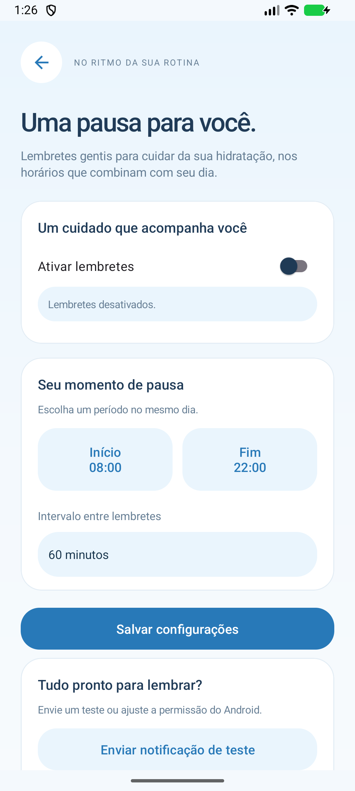
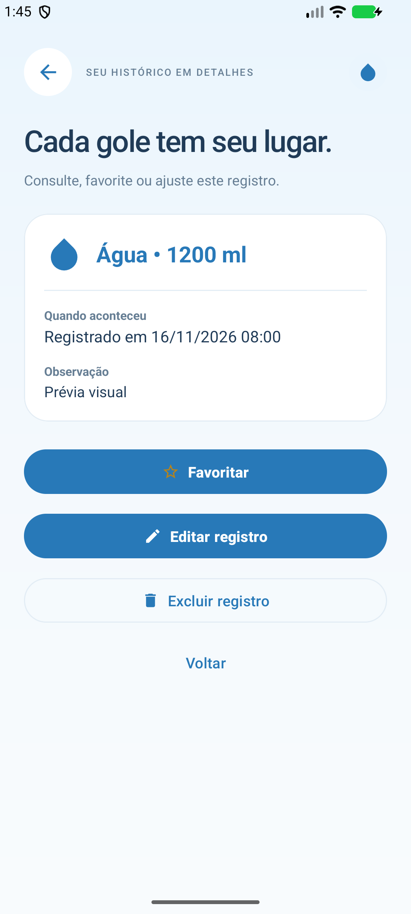

Autores: Guilherme Caleffi Pellens Pereira e Gabriel Cardoso Gonçalves.

Professor: Armando Augusto Piva.

Disciplina: Desenvolvimento de Aplicativos Móveis.

# HIDRATAPP

# HIDRATAPP

# RESUMO

O Hidratapp é um aplicativo Android feito para registrar bebidas e acompanhar uma meta diária estimada de líquidos. Neste trabalho, explicamos a proposta do app, como organizamos os dados, como as telas funcionam e quais testes foram realizados. O código do aplicativo foi escrito em Kotlin, com layouts XML e componentes visuais do Material Components. Os registros ficam em um banco SQLite no celular, enquanto as configurações usam SharedPreferences. A partir do perfil, o app calcula a meta e mostra o consumo por bebida, o histórico e o resumo semanal. Também permite editar registros, marcar favoritos, desfazer exclusões, anotar sintomas, consultar dicas e configurar lembretes. O código foi dividido em partes para facilitar a manutenção, e as consultas ao banco são feitas em segundo plano para não ocupar a execução da tela. O painel acompanha a mudança do dia e mostra uma pequena comemoração ao atingir a meta, uma vez por dia. Na verificação registrada, o APK foi gerado, a análise automática não encontrou erros e passaram 21 testes unitários e 18 testes executados no emulador Android 17. Isso mostra o funcionamento das situações testadas, mas não garante o mesmo resultado em todos os aparelhos. A meta é apenas uma estimativa do projeto, e o app não faz diagnósticos nem substitui orientação profissional.

# LISTA DE ILUSTRAÇÕES

# SUMÁRIO

## 1 INTRODUÇÃO

O Hidratapp foi criado para reunir em um só lugar o que a pessoa bebeu, a quantidade e o horário. Sem esse registro, fica mais difícil consultar o consumo ao longo do dia. A ideia do aplicativo é facilitar esse acompanhamento no próprio celular, mostrando os volumes registrados e uma meta diária estimada.

Neste trabalho, nosso objetivo é colocar em prática os conteúdos da disciplina: criar telas, programar as regras, salvar informações e testar o funcionamento. Ao longo do relatório, explicamos o que o aplicativo precisa fazer, como o código foi organizado e como cada parte participa do uso do app.

O uso começa pelo preenchimento do perfil. Depois, o usuário pode cadastrar bebidas e acompanhar os dados na tela principal, no histórico e nas estatísticas. Também há favoritos, registro de sintomas, dicas e lembretes. O painel separa o consumo por tipo de bebida e mostra o total que conta para a meta.

O aplicativo serve para ajudar na organização pessoal. A meta é calculada por uma regra do projeto e não foi validada para as necessidades de cada pessoa. Da mesma forma, registrar sintomas não permite descobrir suas causas. Essas limitações aparecem no app, junto do aviso de que as dicas não substituem orientação profissional.

Primeiro, apresentamos a proposta e as funções do aplicativo. Depois, explicamos o desenvolvimento, a organização do código e o funcionamento das telas. No final, mostramos como executar o projeto, os resultados dos testes e o que ainda precisa ser avaliado. Mantivemos a apresentação acadêmica em papel A4, fonte Times New Roman 12 e espaçamento de 1,5.

## 2 PROPOSTA E OBJETIVOS

Nossa proposta é juntar perfil, cadastro de bebidas e acompanhamento do consumo em um único aplicativo. Como os dados ficam no celular, as funções principais não precisam de conta nem de conexão com um servidor do projeto. Isso também permite trabalhar o armazenamento de dados dentro de um aplicativo Android.

O objetivo geral é desenvolver e testar um aplicativo Android para organizar o consumo de bebidas e mostrar uma meta estimada. Para isso, o app precisa permitir configurar o perfil, calcular a meta, cadastrar, consultar, editar e excluir bebidas. Também deve oferecer a opção de desfazer uma exclusão, marcar favoritos, consultar estatísticas, registrar sintomas, ler dicas e configurar lembretes.

O aplicativo trabalha com oito tipos de bebida, e cada registro tem data e horário. Na tela inicial, o usuário pode alternar entre os tipos registrados naquele dia. O histórico oferece filtros para encontrar registros, enquanto o gráfico mostra os últimos sete dias sem ser alterado por esses filtros.

Na aparência do nosso app, usamos azul, branco e detalhes em verde-água. Os cartões, títulos e botões procuram deixar as ações fáceis de entender. Essas escolhas fazem parte da proposta visual do projeto, mas ainda não foram comparadas com outras opções em uma pesquisa ou avaliação formal com usuários.

Nesta versão, o aplicativo não tem login, sincronização entre celulares, integração com relógios ou exportação de dados. A proposta também não é definir uma quantidade de líquidos adequada clinicamente para cada pessoa.

## 3 PROCESSO DE DESENVOLVIMENTO E AMBIENTE

Para explicar o desenvolvimento, dividimos o processo em cinco partes: definir as funções, organizar os dados, montar as telas, programar as ações e verificar os resultados. Com essa divisão, a gente consegue explicar melhor como uma necessidade do usuário se transforma em uma ação no aplicativo e em uma situação de teste.

As funções consideradas incluem perfil, registro de bebidas, histórico e informações complementares. Tivemos o cuidado de separar os dados que precisam ser salvos das regras usadas para mostrá-los. As Activities, que são as classes responsáveis pelas telas, conectam os cliques do usuário às funções de cálculo e às operações de armazenamento.

O aplicativo usa Kotlin para a programação, XML para organizar os layouts e Material Components para os elementos visuais. O projeto está configurado com compileSdk e targetSdk 37 e minSdk 24, que definem as versões do Android usadas na compilação e o mínimo aceito. O Gradle usa scripts Kotlin DSL e JDK 17, com compatibilidade Java 11. Essa configuração não significa que o código do app foi escrito em Java. Os testes usam JUnit, AndroidJUnitRunner e Espresso.

O SQLiteOpenHelper ajuda a criar e atualizar o banco de dados. No projeto, BancoHelper faz as consultas e transforma os resultados em objetos que o código consegue usar. BebidaRepository oferece essas operações às telas. Já SharedPreferences guarda configurações simples, como os dados do perfil. O uso do SQLite segue a documentação de armazenamento local do Android.

As verificações registradas usaram o Gradle Wrapper e o emulador Medium_Phone com Android 17. As imagens das telas usam dados de teste. A seção 10 reúne os resultados da geração do app, da análise automática e dos testes.

Ainda não foram feitos estudos com usuários, avaliação clínica, acompanhamento prolongado da bateria ou certificação de acessibilidade. Por isso, os resultados deste trabalho se referem às situações testadas e ao ambiente registrado.

## 4 REQUISITOS DO SISTEMA

O perfil deve receber o sexo usado na fórmula, peso, altura, idade e nível de atividade física. O usuário também pode informar algumas condições de forma opcional. O formulário precisa conferir os valores, permitir alterações e fornecer a mesma meta para todas as telas que a utilizam.

O cadastro deve oferecer água, suco, refrigerante, café, energético, cerveja, vinho e destilado. A quantidade deve ser um número inteiro entre 1 e 5000 ml. A data e o horário precisam ser válidos e não podem estar no futuro. Ao editar, o app deve manter o código do registro e sua marcação de favorito.

O histórico deve permitir filtrar por período, tipo de bebida e favorito. Antes de excluir, o app deve pedir confirmação e oferecer um tempo para desfazer a ação, recuperando as informações originais. As estatísticas devem mostrar os últimos sete dias, incluindo os dias sem registros como zero, e comparar os valores com a meta atual.

O painel deve começar pela categoria Água e permitir trocar de categoria deslizando o dedo ou usando as setas. Os outros tipos aparecem quando há registros naquele dia. Bebidas alcoólicas continuam visíveis, mas não entram no total da meta. O painel também precisa acompanhar a mudança de data e comemorar a meta apenas uma vez por dia.

Os lembretes devem permitir escolher início, fim e intervalo dentro do mesmo dia, além de ativar, testar e acessar as permissões. As dicas e os registros de sintomas devem deixar claro que servem para informação e acompanhamento pessoal. Eles não podem fazer diagnósticos nem afirmar que beber água neutraliza o álcool.

O app também precisa conferir se os dados foram salvos, manter os registros quando o banco for atualizado e recuperar informações importantes quando uma tela for recriada pelo Android. O acesso ao banco deve acontecer em segundo plano. Textos, cores e valores usados em mais de uma tela devem ficar organizados para facilitar futuras alterações.

## 5 ARQUITETURA E ORGANIZAÇÃO DO PROJETO

Dividimos nosso código conforme a função de cada parte. As Activities cuidam das telas e das ações do usuário; os modelos representam os registros; e as classes auxiliares cuidam de cálculos, aparência e armazenamento. São onze Activities: abertura, início, perfil, cadastro, detalhes, histórico e estatísticas, sintomas, dicas, Sobre, lembretes e regras e fontes.

Bebida e Sintoma são os modelos das informações salvas. TipoBebida funciona como uma lista central dos tipos de bebida. Ela reúne o nome, ícone, código da opção de seleção e informações sobre álcool e cafeína. O cadastro, os filtros, os detalhes e o painel consultam essa mesma lista, evitando definir cada categoria novamente em várias partes do código.

BebidaRepository reúne as operações de consultar, salvar, editar e excluir registros. Para acessar o SQLite, ele usa BancoHelper. DadosActivity liga as telas a esse processo, e BancoAsync executa as tarefas em uma fila de segundo plano. Quando o trabalho termina, o resultado volta para a parte do Android responsável por atualizar a tela.

Calculos reúne funções como o cálculo da meta, e PerfilRepository consulta a meta usando o perfil salvo. AjustesDoApp guarda os valores usados nas fórmulas, nos atalhos, no limite do cadastro e nos tempos de interação. Assim, o texto do botão e a quantidade que ele registra usam a mesma configuração.

Outras classes têm tarefas mais específicas. ConsumoDoDia soma as quantidades por bebida; SwipeConsumoLayout reconhece o movimento de deslizar; e HydrationProgressView desenha o progresso. Lembretes e LembreteReceiver cuidam dos avisos, e DicasEngine monta as mensagens educativas. Visual, PageComponents, PaginaSimples e WaterIllustrationView reúnem partes da aparência usadas nas telas.

Com essa separação, a gente consegue organizar melhor o projeto, mas as Activities ainda concentram parte das ações e da montagem visual. O app não usa uma arquitetura MVVM completa, em que a lógica da tela seria separada em outras classes. Também não usa ViewModel, Room ou DataStore. Nesta versão, a principal separação está nas regras compartilhadas e no acesso ao banco.

## 6 MODELO DE DADOS E PERSISTÊNCIA

Cada bebida salva tem os campos id, tipo, ml, data, hora, observacao e favorito. O id é um número gerado pelo banco para identificar o registro. A quantidade é inteira, e favorito usa 0 ou 1 para indicar não ou sim. As datas seguem dd/MM/yyyy e os horários, HH:mm. O código salvo para o tipo de bebida é separado do nome mostrado na tela, então mudar o texto visível não exige renomear os registros.

A tabela de sintomas guarda id, data, sintomas, nivel_sede e observacao. Os sintomas escolhidos são reunidos em um texto. As tabelas de bebidas e sintomas são independentes, sem uma ligação direta por identificador. Quando é necessário consultar informações do mesmo dia, o app usa a data.

O banco se chama hidrata.db e está na versão 3. Quando uma instalação antiga é atualizada, o código verifica quais mudanças são necessárias. Para versões anteriores à 2, cria a tabela de sintomas; para versões anteriores à 3, adiciona o horário às bebidas. Registros antigos que não tinham horário continuam com esse campo vazio.

O histórico organiza os registros por ano, mês e dia, depois por horário e id. Como a data é guardada como texto, a consulta precisa separar suas partes para ordenar corretamente. O id permite encontrar a bebida certa mesmo quando a posição dela na lista muda.

SharedPreferences guarda o perfil, as configurações dos lembretes e a data da última comemoração da meta. Os dados ficam no celular e seguem as regras de backup do Android. O app não tem sincronização própria nem uma proteção adicional de criptografia para o banco.

Ao salvar uma bebida, o banco devolve o id criado. Ao editar ou excluir, informa quantos registros foram alterados. O app confere essas respostas antes de mostrar que deu certo. Para desfazer uma exclusão, mantém uma cópia temporária da bebida e tenta salvá-la com o mesmo id. Se esse número já estiver ocupado, a operação não deve substituir outro registro. Os testes conferem essas operações e a atualização do banco sem perder dados.

## 7 IMPLEMENTAÇÃO DOS FLUXOS

### 7.1 Modelos catálogo e cálculo da meta

TipoBebida é um enum, ou seja, uma lista de opções definidas no código. Para cada bebida, valorBanco guarda a identificação usada no banco, e nomeRes indica o texto em strings.xml. A lista também reúne ícone, identificação do botão e classificações. A consulta reconhece os tipos conhecidos e mantém legíveis os textos que não estão na lista. No modelo Bebida, val impede a troca direta dos campos, e copy permite criar uma versão alterada mantendo as outras informações.

A conta começa com 35 ml por quilo de peso. Para menores de 18 anos, usa 40 ml/kg; acima de 55, usa 30 ml/kg. A atividade física acrescenta 0, 5, 10 ou 15 ml/kg, e a opção masculina multiplica o resultado por 1,05. Esses valores ficam em AjustesDoApp, e a conta é feita em Calculos. Uma pessoa de 70 kg, 30 anos, com opção feminina e atividade moderada tem meta de 3150 ml. Com a opção masculina, o resultado é 3307 ml, pois a conversão para número inteiro descarta a parte decimal. Essa é uma estimativa do projeto, não uma prescrição de saúde.

### 7.2 Validação gravação e manutenção do esquema

Ao atualizar o banco, o código olha a versão antiga para saber o que falta mudar. O comando ALTER TABLE adiciona o campo de horário sem apagar as bebidas existentes. Os testes usam bancos das versões 1 e 2 e conferem se os dados continuam disponíveis depois da atualização, além de testar o cadastro, a consulta, a edição e a exclusão.

O cadastro identifica qual opção de bebida foi selecionada e salva seu valorBanco. Os atalhos acrescentam quantidade ao campo de volume até o limite de AjustesDoApp. Antes de salvar, o código também confere a data e o horário, recusando valores inválidos ou momentos no futuro.

Depois dessas conferências, a tela cria um objeto Bebida e pede ao repositório para salvá-lo usando a função dados. Na edição, copy mantém o id e o favorito enquanto altera os campos escolhidos. O botão fica desativado durante a gravação para evitar novos cliques, e o app só confirma o sucesso após a resposta do banco. Se o Android recriar a tela, os campos e a seleção são recuperados.

### 7.3 Acompanhamento diário e lembretes

ConsumoDoDia soma os registros do dia e separa as quantidades por tipo de bebida. Água fica sempre na primeira posição. Quando existe outra categoria, o painel também oferece uma página com o total que conta para a meta, sem álcool. Deslizar para os lados ou tocar nas setas só muda o que aparece na tela, sem alterar os registros. A rolagem vertical continua disponível.

Lembretes calcula o próximo aviso e usa AlarmManager, o serviço de alarmes do Android, para programá-lo. Quando chega o momento, LembreteReceiver mostra a notificação, se houver permissão, e agenda a seguinte. O código também trata a reinicialização do celular, atualizações do app e mudanças de data ou fuso. Os horários são aproximados e dependem do Android. As notificações precisam estar autorizadas e com o canal de avisos habilitado.

### 7.4 Execução assíncrona e continuidade do uso

BancoAsync faz as operações do banco em segundo plano para deixar a execução da tela disponível. runCatching guarda se a operação deu certo ou falhou, e Handler entrega a resposta à parte que atualiza a interface. Antes de mostrar o resultado, DadosActivity verifica se a tela ainda está aberta. Esse caminho é usado no cadastro, nos detalhes, no histórico, nas dicas, nos sintomas e nos atalhos.

RotinaDiaria calcula quando será a próxima meia-noite no horário local. Nesse momento, MainActivity atualiza a data e busca os registros do novo dia. A atualização também acontece quando a tela volta a aparecer e quando o Android informa uma mudança de horário. Quando a tela deixa de ficar visível, seu agendamento é cancelado.

Quando o total que conta para a meta atinge o valor esperado, o painel mostra uma mensagem e uma pequena animação. O app salva a data dessa comemoração para não repeti-la no mesmo dia. Se as animações estiverem desligadas no sistema, essa escolha é respeitada. A mensagem também não remove a opção de desfazer um registro rápido.

Ao excluir uma bebida, DetalheBebidaActivity guarda uma cópia do registro por dez segundos. Nesse tempo, os dados continuam visíveis e o usuário pode tocar em Desfazer. A cópia e o prazo são recuperados se o Android recriar a tela. Ao restaurar, o repositório impede que um registro já existente com o mesmo id seja substituído.

## 8 INTERFACE E JORNADA DE USO

O app começa com uma tela ilustrada e depois apresenta a configuração do perfil. As cores azuis, a água e os fundos claros fazem parte da identidade visual. Se a tela de abertura for encerrada, o código cancela a passagem automática para a próxima tela, evitando abrir outra página depois que o usuário saiu.

### 8.1 Configuração do perfil

O perfil é preenchido em quatro etapas, com a opção de sexo usada na fórmula, as medidas, a atividade física e os cuidados opcionais. No resumo, o usuário confere a meta e segue para o acompanhamento do dia. Se a tela for recriada pelo Android, o app recupera a etapa e os campos. O perfil também pode ser editado pelo menu inferior.

### 8.2 Registro e acompanhamento

Na tela de cadastro, a quantidade fica em destaque, as bebidas aparecem agrupadas e o botão de salvar fica na parte inferior. As opções de seleção usam um mesmo layout XML e mudam de aparência quando escolhidas. Os nomes e as mensagens ficam em strings.xml, e as cores também têm arquivos próprios. No painel, alternar entre os tipos ajuda a entender de qual bebida vem cada quantidade.

### 8.3 Histórico estatísticas e lembretes

No histórico, o usuário pode combinar filtros para encontrar os registros. O gráfico continua mostrando o resumo da semana. Na tela de lembretes, ficam as opções de ativar, definir horários e intervalo, testar o aviso e conferir permissões. Cabeçalhos e cartões seguem o mesmo estilo entre as telas. Nas dicas, é possível abrir o texto completo e depois recolhê-lo.

### 8.4 Detalhes e recuperação de registros

Nos detalhes de uma bebida, é possível consultar o horário e a observação, marcar como favorita e editar. Ao confirmar a exclusão, o usuário tem dez segundos para desfazer. O cartão continua visível nesse período, mesmo se a tela for recriada. Ao desfazer, o app recupera as informações do registro.

## 9 DECISÕES TÉCNICAS E LIMITAÇÕES

Escolhemos usar componentes do Android e salvar os dados no celular para aplicar os conteúdos da disciplina. Com SQLiteOpenHelper, o projeto mostra diretamente como criar tabelas, fazer consultas e atualizar o banco. Por outro lado, tivemos que cuidar manualmente dessas mudanças no código. O repositório e a fila ajudam a separar o acesso aos dados da atualização das telas.

As operações do SQLite são feitas em segundo plano, mas isso não significa que o desempenho foi medido. Ainda não foram realizados testes com muitos registros nem medições organizadas de memória, tempo de resposta ou bateria. A fila executa uma tarefa por vez, e as Activities ainda coordenam parte das ações.

Guardar datas e horários como texto exige cuidado na leitura e na ordenação. O app também não guarda separadamente o momento do cadastro e o momento do consumo. No gráfico, os sete dias são comparados com a meta atual, sem guardar metas antigas. Já a sequência de bebidas alcoólicas não considera dose, teor alcoólico ou intervalo. Mesmo ao cadastrar uma bebida de uma data passada, o aviso de inclusão consulta o dia atual.

Para testar a mudança de dia, foi usado um relógio controlado pelo teste e acionada a função que o agendamento utiliza. Também há testes para a próxima meia-noite na mudança de ano e no horário de verão. Essas verificações não substituem deixar o app funcionando durante várias viradas reais em aparelhos diferentes.

Os testes no Android 17 ainda precisam ser complementados com aparelhos físicos e celulares de outros fabricantes. Também falta avaliar o uso com leitor de tela e fonte ampliada. A recuperação do backup do Android e possíveis atrasos longos nas notificações precisam de mais testes. O app não permite exportar ou importar um arquivo de backup.

A fórmula da meta e as mensagens não foram validadas para as necessidades de cada pessoa. Pela regra do app, todo o volume de bebidas sem álcool entra no total, mas isso não significa que elas tenham o mesmo valor nutricional. As referências ajudam a explicar o tema da hidratação, sem comprovar os valores escolhidos para a fórmula.

## 10 VERIFICAÇÃO E RESULTADOS

Na nossa verificação, procuramos conferir as funções em situações que podem ser repetidas. O comando assembleDebug gerou a versão de teste do aplicativo com a mensagem BUILD SUCCESSFUL. O lintDebug, ferramenta que procura problemas no código, não encontrou erros nem avisos de HardcodedText nos layouts, que indicariam textos escritos diretamente nesses arquivos. Ainda existem outros avisos, então o resultado não significa que todos os possíveis problemas foram eliminados.

Na execução registrada, passaram 21 testes unitários, voltados a funções isoladas, e 18 testes instrumentados, que rodam no ambiente Android. Os instrumentados foram executados no emulador Medium_Phone com Android 17. O quadro abaixo mostra quantos testes há em cada grupo.

| Suíte | Testes | Resultado |
|---|---|---|
| CalculosTest | 10 | Aprovados |
| ConsumoDoDiaTest | 5 | Aprovados |
| TipoBebidaTest | 3 | Aprovados |
| RotinaDiariaTest | 3 | Aprovados |
| BancoMigrationTest | 3 | Aprovados |
| FluxosTest | 11 | Aprovados |
| MelhoriasTest | 3 | Aprovados |
| NotificacaoTest | 1 | Aprovado |
| Total | 39 | Sem falhas |

Os testes unitários conferem os cálculos, os tipos de bebida, as somas do dia e as regras de data. Os instrumentados verificam a atualização do banco, o cadastro, a consulta, a edição e a exclusão, além do perfil, dos filtros, dos gestos e da recuperação das telas. Também conferem o desfazer e se o banco trabalha em segundo plano. O teste de mudança de dia verifica a nova consulta e o controle da comemoração da meta.

NotificacaoTest confere se o Android publica o aviso. Ele não comprova que a notificação chega pontualmente depois de um período longo com o celular em repouso. Também não foram medidos o percentual de código coberto pelos testes, o desempenho ou a eficácia clínica. Os dados criados pelos testes são removidos ao final de cada situação.

## 11 PROCEDIMENTOS DE EXECUÇÃO E USO

Para abrir o projeto, selecione no Android Studio a pasta que contém settings.gradle.kts. Aguarde a sincronização do Gradle e tenha JDK 17 e SDK 37 disponíveis. Para rodar, use um emulador ou celular com API 24 ou superior. O computador pode precisar de internet para baixar as dependências, que são as bibliotecas usadas pelo projeto.

No Windows, execute .\gradlew.bat :app:assembleDebug :app:testDebugUnitTest :app:lintDebug --console=plain. O APK fica em app/build/outputs/apk/debug/app-debug.apk. Os relatórios unitários e estáticos ficam nos diretórios app/build/reports/tests e app/build/reports.

Com um emulador de teste conectado, execute .\gradlew.bat :app:connectedDebugAndroidTest para rodar os testes no Android. Na execução documentada, o app e o pacote de testes foram instalados e os testes foram iniciados pelo comando am instrument, usando AndroidJUnitRunner. O registro dessa execução está em app/build/qa/guia_ajustes_instrumentados.txt.

No primeiro acesso, toque em Vamos começar e preencha as quatro etapas. Informe as medidas, escolha a atividade física e confira o resumo. Para conferir o exemplo de meta de 3150 ml, use 70 kg, 30 anos, opção feminina e atividade moderada.

Na tela principal, os atalhos de 200, 300 e 500 ml registram água e permitem desfazer por seis segundos. O botão principal abre o cadastro completo, em que você escolhe a bebida e informa quantidade, data e horário. A observação é opcional. Os volumes dos atalhos e o limite do cadastro ficam definidos em AjustesDoApp.

### 11.1 Consulta edição e informações complementares

Deslize sobre o círculo ou toque nas setas para consultar o consumo por tipo de bebida. Água aparece primeiro, e as outras categorias dependem do que foi registrado no dia. O total da meta não inclui álcool. Trocar a página só muda a visualização. A data é atualizada na virada do dia e ao voltar à tela, e a comemoração usa a soma válida e a meta atual.

Em Evolução, consulte o gráfico da semana e use os filtros do histórico. Toque em um registro para ver detalhes, favoritar, editar ou excluir. Depois de confirmar uma exclusão, a opção Desfazer fica disponível por dez segundos. Ao recuperar a bebida, o app mantém o id, horário, favorito e observação.

Em Lembretes, escolha início, fim e intervalo e salve. Permita as notificações quando o Android solicitar e use o botão de teste para conferir se o aviso aparece. Os horários são aproximados. Se você forçar a parada do app nas configurações do celular, os lembretes ficam suspensos até ele ser aberto novamente.

Na tela de sintomas, marque o que percebeu e informe o nível de sede. Se quiser, acrescente uma observação antes de salvar. Os relatos podem ser excluídos pelo histórico. Nas dicas, Ler dica abre o texto completo e Recolher volta à versão resumida. Essas mensagens não descobrem a causa dos sintomas.

A área de regras e fontes explica os valores da fórmula e os limites do app. O uso não exige conta, e os dados não são sincronizados pelo projeto. Uma possível recuperação pelo backup do Android depende das configurações do celular e ainda não foi verificada nos testes apresentados.

## 12 AVALIAÇÃO TÉCNICA

A avaliação observa se as funções previstas aparecem no código e funcionam nas situações testadas. No registro de uma bebida, por exemplo, o usuário escolhe o tipo, o app confere os campos, monta o objeto e salva no banco para consultar depois. Os testes de edição e de desfazer verificam se os dados são mantidos. Já os testes de recriação conferem se a tela recupera as informações necessárias para continuar o uso.

A lista central TipoBebida permite usar os mesmos tipos no cadastro, nos filtros, no histórico e nas regras. Os nomes exibidos ficam separados dos valores salvos no banco. Os ajustes compartilhados ajudam a manter os botões, mensagens e cálculos com os mesmos valores. Os arquivos de aparência também deixam as mudanças visuais mais organizadas.

O repositório e a fila definem um caminho comum para acessar o SQLite. O teste confirma que a operação acontece em segundo plano na situação verificada, mas não mede quanto isso melhora o desempenho. O acompanhamento diário reúne a consulta por data, o agendamento e a data da comemoração. Para conferir essas regras, os testes usam um relógio controlado.

A geração do app e os 39 testes aprovados mostram que as situações descritas funcionaram no ambiente registrado. As imagens e os trechos de código ajudam a ligar cada função às classes responsáveis. A análise automática complementa essa conferência, mas ainda são necessárias avaliações de segurança, acessibilidade e uso por mais tempo.

Nossa avaliação está ligada ao desenvolvimento acadêmico e ao funcionamento do aplicativo. Como próximos passos, é necessário testar aparelhos físicos, recursos de acessibilidade, bancos com mais registros, recuperação de backup e proteção dos dados. Esses pontos ainda precisam ser avaliados e não fazem parte dos resultados já demonstrados.

## 13 CONSIDERAÇÕES FINAIS

Com o Hidratapp, conseguimos reunir no nosso projeto os principais conteúdos usados no desenvolvimento de um aplicativo Android. O app permite configurar o perfil, registrar bebidas, acompanhar o consumo e consultar o histórico. Também inclui sintomas, dicas e lembretes. Para isso, o projeto combina telas XML, regras em Kotlin e dados salvos no próprio celular.

Ao dividir o código, tivemos o cuidado de definir o papel de cada parte: TipoBebida organiza as categorias, Calculos faz as contas, as Activities cuidam da interação e o repositório encaminha as operações ao banco. As tarefas em segundo plano e a recuperação dos campos das telas ajudam o usuário a continuar o cadastro, a consulta, a edição e o desfazer sem perder informações importantes.

Na verificação registrada, o aplicativo foi gerado, a análise automática não encontrou erros e os testes unitários e instrumentados passaram. Com esses resultados, a gente consegue mostrar o funcionamento das situações avaliadas, dentro dos limites do ambiente de teste. A meta continua sendo uma estimativa, sem validação individual de saúde. O projeto pode ser ampliado com avaliações de uso, acessibilidade, desempenho e proteção dos dados.
