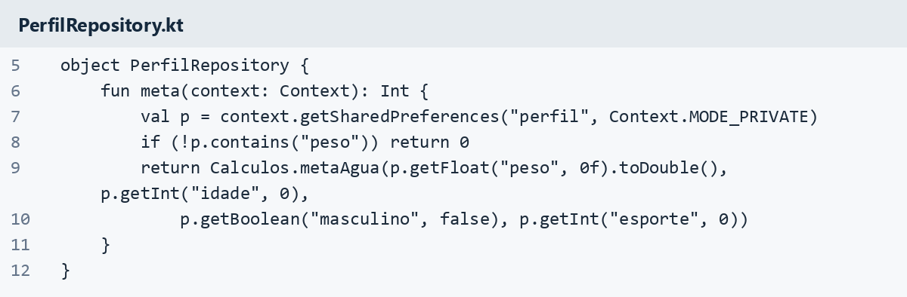
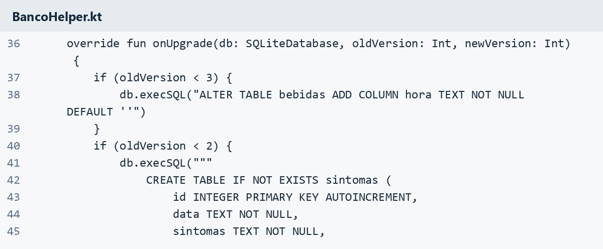
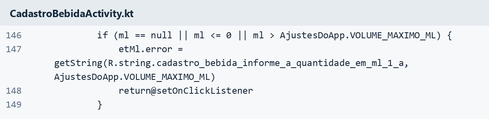
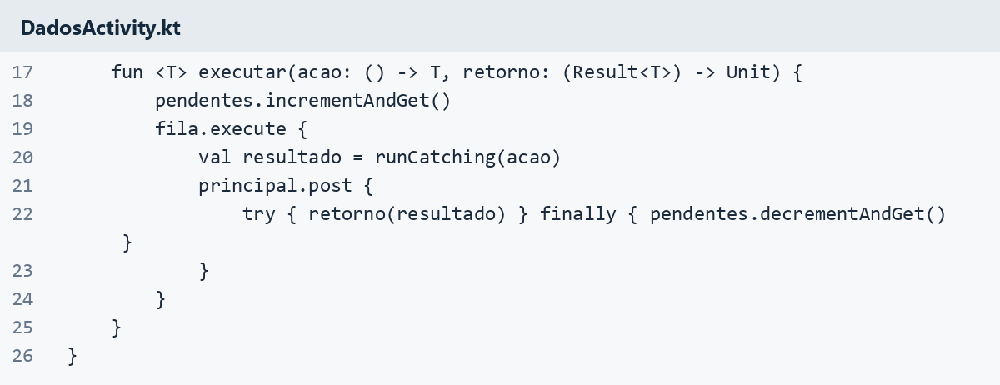
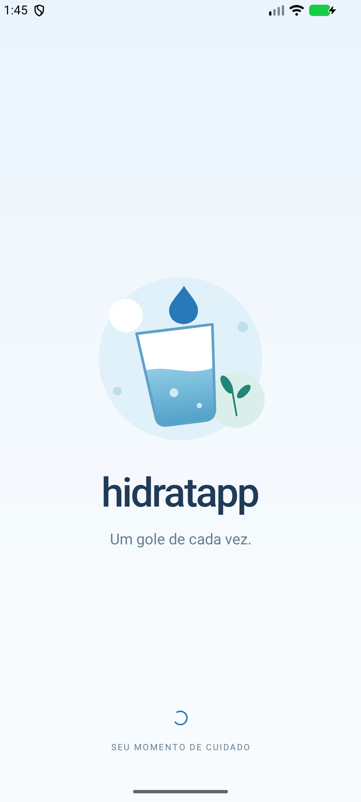
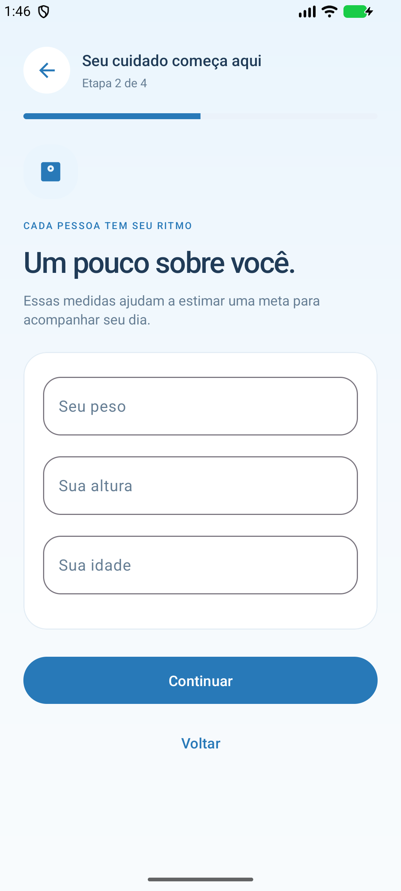
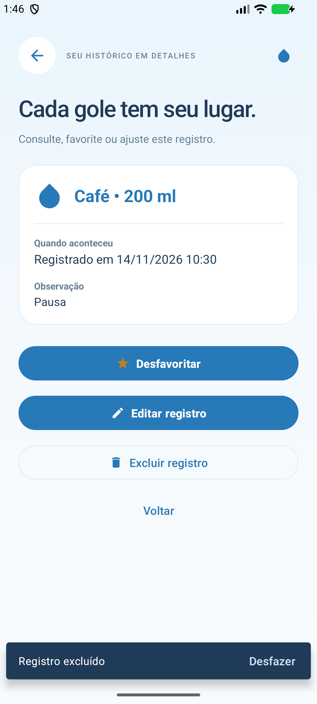

Autores: Guilherme Caleffi Pellens Pereira e Gabriel Cardoso Gonçalves.

Professor: Armando Augusto Piva.

Disciplina: Desenvolvimento de Aplicativos Móveis.

# HIDRATAPP

# HIDRATAPP

# RESUMO

O Hidratapp é um aplicativo Android desenvolvido para organizar registros de bebidas e acompanhar uma meta diária estimada de ingestão de líquidos. O trabalho descreve o processo de definição dos requisitos, modelagem dos dados, construção das interfaces, implementação das regras e verificação do sistema. A solução utiliza Kotlin, layouts XML, Material Components, SQLite e preferências locais. O perfil fornece os dados da estimativa; os registros alimentam o painel por categoria, o histórico e as estatísticas semanais. A interação inclui configuração inicial, favoritos, edição, exclusão com possibilidade de desfazer, relatos de sintomas, dicas educativas e lembretes locais. A organização do código reúne um catálogo de bebidas em enum, parâmetros compartilhados, um repositório de persistência e execução das operações SQLite em segundo plano. O painel trata a mudança de data e apresenta uma comemoração discreta da meta, limitada a uma vez por dia. A verificação compreende compilação do APK, análise estática sem erros, 21 testes unitários e 18 instrumentados aprovados em emulador Android 17. Esses resultados sustentam os cenários exercitados, sem demonstrar funcionamento em todos os aparelhos ou validação clínica das estimativas. O aplicativo se destina à organização pessoal e não constitui instrumento de diagnóstico ou prescrição individual.

# LISTA DE ILUSTRAÇÕES

# SUMÁRIO

## 1 INTRODUÇÃO

O registro do consumo de bebidas envolve informar o que foi consumido, em qual quantidade e em que momento. Quando essas informações ficam dispersas, a consulta do próprio histórico se torna menos prática. O Hidratapp reúne os registros em uma aplicação Android de uso local, com uma interface para acompanhar volumes e uma meta diária estimada.

O objetivo acadêmico do trabalho é integrar interface, regras de negócio, persistência e testes em um sistema executável. A exposição acompanha a passagem dos requisitos para o modelo de dados, a organização das classes, a construção da jornada de uso e a avaliação dos cenários implementados.

A interação começa pela configuração do perfil. Em seguida, o usuário pode registrar bebidas e consultar seus dados no painel, no histórico e nas estatísticas. Favoritos, relatos de sintomas, conteúdo educativo e lembretes complementam essa organização. A apresentação dos volumes distingue cada categoria e o total considerado na meta.

A finalidade do sistema é apoiar a organização pessoal. A meta utiliza uma regra estimativa do projeto, sem validação clínica individual. Relatos de sintomas não permitem determinar suas causas, e as mensagens educativas não substituem orientações profissionais. Esses limites também são apresentados na interface.

O relatório apresenta a proposta e os requisitos, descreve o processo de desenvolvimento e explica os componentes que sustentam o funcionamento. As seções finais reúnem os procedimentos de execução, os resultados dos testes e as limitações da avaliação. O texto adota apresentação acadêmica em A4, com corpo Times New Roman 12 e espaçamento de 1,5, com consulta ao material de normalização do COTUCA (Unicamp, s.d.).

## 2 PROPOSTA E OBJETIVOS

A proposta consiste em reunir perfil, registro de bebidas e consulta do consumo em um único aplicativo. O armazenamento local permite executar as operações centrais sem conta e sem conexão com um servidor próprio, mantendo o foco na implementação de uma aplicação mobile com persistência.

O objetivo geral é desenvolver e verificar um sistema Android para organizar registros de consumo e apresentar uma meta estimada. Os objetivos específicos abrangem configurar o perfil; calcular a meta de modo consistente; cadastrar, editar, consultar e excluir bebidas; recuperar uma exclusão recente; manter favoritos; apresentar estatísticas; registrar sintomas; oferecer conteúdo educativo; e configurar lembretes.

O recorte funcional considera oito categorias de bebida e registros identificados por data e horário. A página inicial apresenta o consumo por categoria e permite navegar entre os tipos registrados no dia. O histórico oferece filtros, enquanto as estatísticas apresentam os últimos sete dias de forma independente desses filtros.

A organização visual utiliza azul, branco e detalhes em verde-água. Os títulos, cartões, opções de seleção e ações de navegação procuram tornar o registro compreensível. Essa decisão constitui uma orientação de interface do projeto; não decorre de um estudo comparativo de mercado ou de uma avaliação formal com usuários.

Autenticação, sincronização entre aparelhos, integração com relógios e exportação de dados pelo aplicativo não integram o escopo. O trabalho também não pretende estabelecer uma recomendação clínica individual de ingestão de líquidos.

## 3 PROCESSO DE DESENVOLVIMENTO E AMBIENTE

O processo é apresentado a partir de cinco atividades relacionadas: delimitar os requisitos, modelar os registros, organizar a interface, implementar os fluxos e verificar os resultados. Essa organização permite explicar como uma necessidade de uso se relaciona com uma estrutura de dados, uma ação na tela e um cenário de teste.

Na definição dos requisitos, foram considerados o perfil, o registro de consumo, a consulta do histórico e as informações complementares. A modelagem distingue os dados persistidos das regras de apresentação. A implementação conecta os eventos das Activities às operações do repositório e às funções compartilhadas de cálculo.

O ambiente utiliza Kotlin, layouts XML e Material Components. compileSdk e targetSdk são 37; minSdk é 24. O Gradle utiliza Kotlin DSL e daemon configurado para JDK 17, com compatibilidade Java 11. A verificação utiliza JUnit, AndroidJUnitRunner e Espresso.

SQLiteOpenHelper fornece o gerenciamento do banco estruturado, e SharedPreferences guarda configurações pequenas. BancoHelper executa consultas e converte cursores, enquanto o repositório oferece operações para as telas. O uso de SQLite segue o modelo de armazenamento local descrito pela documentação Android (Google, s.d.a).

As verificações empregam o Gradle Wrapper e o emulador Medium_Phone com Android 17. O conjunto de fontes analisado tem identificador d9922fad, calculado a partir dos arquivos locais; capturas.json registra os trechos e os resumos SHA-256 de suas fontes. As imagens da interface utilizam dados de teste. Os resultados de compilação, lint e testes são consolidados na seção 10.

Não foram conduzidos estudo com usuários, avaliação clínica, medição prolongada de bateria ou certificação de acessibilidade. O alcance das conclusões permanece vinculado aos cenários e ao ambiente de execução registrados.

## 4 REQUISITOS DO SISTEMA

O perfil deve receber sexo usado na estimativa, peso, altura, idade, atividade física e condições declaradas opcionalmente. O formulário deve validar as entradas, permitir edição e disponibilizar uma meta consistente nas telas que a utilizam.

O cadastro deve oferecer água, suco, refrigerante, café, energético, cerveja, vinho e destilado. O volume deve ser inteiro entre 1 e 5000 ml na configuração adotada. Data e horário devem ser válidos e não representar um instante futuro. A edição deve preservar identificador e favorito.

A consulta deve permitir filtros por período, categoria e favorito. A exclusão de uma bebida deve solicitar confirmação e oferecer um prazo para desfazer, preservando os campos do registro restaurado. As estatísticas devem mostrar os últimos sete dias, com zeros nos dias sem registros e comparação com a meta vigente.

O painel deve iniciar pela categoria Água e permitir navegação por gesto ou setas. Outros tipos aparecem quando há registros na data consultada. Bebidas alcoólicas permanecem visíveis, mas ficam fora do total válido da meta. O painel deve atualizar o dia consultado e limitar a comemoração da meta a uma vez por data.

Os lembretes devem oferecer intervalo, início e fim no mesmo dia, ativação, teste e acesso às permissões. Os relatos de sintomas e as dicas devem comunicar sua finalidade educativa, sem produzir diagnóstico ou afirmar que água neutraliza álcool.

Como requisitos de qualidade, o sistema deve conferir o resultado das gravações, preservar dados em migrações, manter estado relevante na recriação das telas e executar as operações SQLite fora da thread principal. Textos, parâmetros compartilhados e papéis de cor devem ter pontos definidos de manutenção.

## 5 ARQUITETURA E ORGANIZAÇÃO DO PROJETO

A estrutura utiliza Activities para eventos e componentes visuais, modelos para os registros e auxiliares para regras, apresentação e persistência. Onze Activities concretas são declaradas: abertura, início, perfil, cadastro, detalhes, histórico e estatísticas, sintomas, dicas, Sobre, lembretes e regras e fontes.

Bebida e Sintoma representam os dados persistidos. TipoBebida reúne a identificação da categoria, o recurso de nome, o ícone, o ID do chip e as classificações de álcool e cafeína. O cadastro percorre o catálogo para criar as opções; filtros, detalhes, carrossel e regras consultam a mesma definição.

BebidaRepository concentra as operações de registros e utiliza BancoHelper para acessar o SQLite. DadosActivity oferece a ligação entre as telas e esse repositório. BancoAsync executa o trabalho em uma fila de segundo plano e devolve o resultado à thread principal, onde os componentes da interface são atualizados.

Calculos reúne as funções de domínio, e PerfilRepository fornece os dados da meta. AjustesDoApp concentra coeficientes, volumes dos atalhos, limite de cadastro e tempos de interação. Os rótulos dos atalhos e a mensagem de limite utilizam esses parâmetros, evitando que a ação e o texto apresentem valores diferentes.

ConsumoDoDia agrupa os volumes por categoria; SwipeConsumoLayout reconhece gestos; HydrationProgressView desenha o indicador. Lembretes e LembreteReceiver tratam alarmes e notificações. DicasEngine produz mensagens educativas. Visual, PageComponents, PaginaSimples e WaterIllustrationView compartilham elementos de apresentação.

A divisão de responsabilidades não corresponde a uma implementação completa de MVVM. O sistema não utiliza ViewModel, Room ou DataStore. As Activities ainda coordenam eventos e a montagem de parte do conteúdo visual; a separação existente concentra o acesso ao banco e as regras reutilizadas.

## 6 MODELO DE DADOS E PERSISTÊNCIA

A modelagem de bebidas utiliza id, tipo, ml, data, hora, observacao e favorito. O identificador é autoincrementável, o volume é inteiro e favorito é representado por 0 ou 1. Data e hora utilizam os formatos dd/MM/yyyy e HH:mm. O valor de categoria gravado é separado do recurso do nome visível, permitindo alterar o rótulo sem renomear registros.

A tabela sintomas contém id, data, sintomas, nivel_sede e observacao. Os itens selecionados são unidos em texto. As tabelas não possuem chave estrangeira entre si; consultas relacionadas ao dia utilizam a data.

O banco hidrata.db utiliza o esquema 3. O procedimento de migração cria sintomas para instalações anteriores à versão 2 e adiciona hora para versões anteriores à 3. O valor padrão vazio conserva a ausência de horário nos registros que não possuem essa informação.

A ordenação do histórico considera ano, mês e dia, seguidos por horário e identificador. Como a data é armazenada em texto, a consulta utiliza seus componentes para produzir uma ordem cronológica. O identificador permite localizar uma linha sem depender de sua posição na lista.

SharedPreferences mantém perfil, configurações de lembretes e o marcador da comemoração diária. O armazenamento é local e sujeito às regras de backup do Android. O aplicativo não oferece sincronização própria ou uma camada adicional de criptografia do banco.

Inserções retornam identificador; alterações e exclusões retornam linhas afetadas. A aplicação verifica esses resultados antes de confirmar a operação. Para desfazer a exclusão, conserva uma cópia temporária da bebida e tenta inseri-la com o mesmo ID; uma colisão não deve sobrescrever outra linha. Os testes verificam migrações, operações CRUD e preservação dos campos.

## 7 IMPLEMENTAÇÃO DOS FLUXOS

### 7.1 Modelos catálogo e cálculo da meta

O enum associa valorBanco a nomeRes, ícone, ID e classificações. valorBanco identifica a categoria persistida; nomeRes aponta para strings.xml. O método de consulta reconhece as categorias do catálogo e mantém legíveis textos desconhecidos. Bebida utiliza val e copy para preservar campos na edição.

A regra parte de 35 ml/kg, usa 40 abaixo de 18 anos e 30 acima de 55. A atividade acrescenta 0, 5, 10 ou 15 ml/kg; o indicador masculino aplica 1,05. Os coeficientes ficam em AjustesDoApp e a função em Calculos. Para 70 kg, 30 anos, feminino e atividade moderada, o resultado é 3150 ml; no indicador masculino, 3307 ml após a conversão para Int. A estimativa não é uma prescrição clínica.

### 7.2 Validação gravação e manutenção do esquema

O gerenciamento do esquema utiliza a versão de origem para decidir quais comandos executar. ALTER TABLE acrescenta o horário sem remover bebidas. A verificação utiliza bancos de teste das versões 1 e 2, confere a preservação dos dados e exercita as operações de persistência.

O cadastro lê a categoria da tag do chip e utiliza valorBanco na gravação. Os atalhos somam ao campo de volume até o limite definido em AjustesDoApp. A interpretação estrita da data e do horário recusa entradas inválidas e instantes futuros.

Depois da validação, a Activity monta Bebida e chama o repositório pela função dados. Na edição, copy conserva identificador e favorito. O botão fica desabilitado durante a gravação e o sucesso depende do retorno esperado do banco. A restauração de estado preserva a seleção e os campos ao recriar a tela.

### 7.3 Acompanhamento diário e lembretes

ConsumoDoDia soma os registros da data e organiza as páginas conforme o catálogo. Água permanece na primeira posição. Havendo outra categoria, uma página reúne o total válido sem álcool. O gesto horizontal e as setas mudam a seleção sem alterar o banco, enquanto a rolagem vertical continua disponível.

Lembretes calcula o próximo horário e programa AlarmManager. O receptor publica o aviso quando permitido e reagenda o próximo. Reinicialização, atualização do pacote e mudanças de data ou fuso também são tratadas. Os horários são aproximados e dependem das condições do Android (Google, s.d.b); notificações exigem autorização e canal habilitado (Google, s.d.c).

### 7.4 Execução assíncrona e continuidade do uso

A fila de BancoAsync executa a operação do repositório fora da thread principal. runCatching representa sucesso ou falha, e Handler agenda a entrega à interface. DadosActivity confere se a tela não foi destruída ou encerrada antes de atualizar seus componentes. Esse fluxo é utilizado por cadastro, detalhes, histórico, dicas, sintomas e atalhos.

A continuidade diária utiliza RotinaDiaria para calcular a próxima meia-noite no fuso local. MainActivity atualiza a data e consulta os registros quando o horário é alcançado, quando recebe os eventos previstos de mudança de horário e quando volta ao primeiro plano. Ao deixar de estar visível, cancela o agendamento da tela.

Ao atingir a meta válida, o painel apresenta uma mensagem e um pulso discreto. Uma preferência registra a data da comemoração para impedir repetição na mesma data; a animação respeita sua desativação no sistema. A opção Desfazer do registro rápido permanece disponível, sem ser substituída por outra barra de mensagem.

Na exclusão, DetalheBebidaActivity conserva a bebida e o prazo de dez segundos. Durante esse intervalo, mantém os dados visíveis e oferece a restauração. A cópia e o prazo são preservados na recriação da tela. O repository utiliza inserção que falha em colisões de ID, preservando uma linha já existente.

## 8 INTERFACE E JORNADA DE USO

A jornada começa com uma abertura ilustrada e uma apresentação do perfil. A identidade visual utiliza água, azul e superfícies claras. O encerramento da abertura cancela sua transição pendente, evitando navegação depois que a tela deixa de ser utilizada.

### 8.1 Configuração do perfil

A configuração organiza sexo usado na fórmula, medidas, atividade física e cuidados opcionais em quatro etapas. O resumo permite conferir a meta e acessar o dia. A etapa e os campos são preservados na recriação da Activity, e o perfil pode ser editado pela navegação inferior.

### 8.2 Registro e acompanhamento

O cadastro destaca a quantidade, agrupa as opções e mantém a ação de salvar na base. Os chips compartilham um XML e seletores de estado. Nomes e mensagens ficam em strings.xml; a paleta e as cores de seleção utilizam recursos definidos. No painel, a navegação por tipo esclarece a origem do volume exibido.

### 8.3 Histórico estatísticas e lembretes

O histórico combina filtros, enquanto o gráfico apresenta o resumo semanal. Os lembretes agrupam ativação, período, intervalo, teste e permissões. Componentes de cabeçalho e cartões mantêm continuidade visual entre as telas. As dicas permitem expandir e recolher seu conteúdo.

### 8.4 Detalhes e recuperação de registros

Os detalhes permitem consultar horário e observação, favoritar e editar. Após confirmar uma exclusão, o usuário dispõe de dez segundos para desfazer. O cartão permanece visível durante esse prazo, inclusive depois de recriar a tela; a restauração recupera os campos do registro.

## 9 DECISÕES TÉCNICAS E LIMITAÇÕES

A escolha de componentes Android e armazenamento local aproxima o projeto dos fundamentos da disciplina. SQLiteOpenHelper permite explicitar esquema, consultas e migrações, mas exige sua manutenção manual. O repositório e a fila separam o trabalho de persistência da atualização dos componentes visuais.

A execução em segundo plano evita realizar as operações SQLite na thread principal; isso não constitui medição de desempenho. Não foram executados ensaios com bases extensas nem medições sistemáticas de memória, tempo ou bateria. A fila é serial e as Activities continuam responsáveis por coordenar parte dos fluxos.

Datas e horários em texto exigem interpretação e ordenação explícitas. O sistema não separa o instante de inclusão do instante de consumo. O gráfico utiliza a meta vigente nos sete dias e não armazena metas históricas. A sequência de álcool não considera doses, teor ou intervalo; o diálogo de inclusão consulta o dia corrente mesmo em um cadastro retroativo.

A virada diária é verificada com relógio controlado e acionamento do callback empregado pelo agendamento. Há teste da próxima meia-noite em mudança de ano e horário de verão. Esses cenários não equivalem a um ensaio prolongado aguardando a virada real em vários aparelhos.

A execução em Android 17 não substitui testes físicos, leitor de tela, fonte ampliada ou diferentes fabricantes. A restauração do backup do Android e atrasos prolongados de notificações exigem avaliação adicional. O aplicativo não oferece exportação ou importação de backup em arquivo.

A fórmula e as mensagens não possuem validação clínica individual. O total considera integralmente o volume sem álcool como uma regra do sistema, sem afirmar equivalência nutricional entre bebidas. As referências educativas contextualizam o tema, mas não validam os coeficientes adotados (CDC, 2026; NHS, s.d.).

## 10 VERIFICAÇÃO E RESULTADOS

A verificação relaciona requisitos a cenários reproduzíveis. A compilação de depuração com assembleDebug terminou com BUILD SUCCESSFUL. lintDebug não registrou erros e não apontou HardcodedText nos layouts; permanecem avisos estáticos, de modo que o resultado não demonstra ausência de todos os problemas potenciais.

A execução reúne 21 testes unitários e 18 instrumentados aprovados no emulador Medium_Phone com Android 17. O quadro apresenta a distribuição por suíte.

| Suíte | Testes | Resultado |
|---|---|---|
| CalculosTest | 10 | Aprovados |
| ConsumoDoDiaTest | 5 | Aprovados |
| TipoBebidaTest | 3 | Aprovados |
| RotinaDiariaTest | 3 | Aprovados |
| BancoMigrationTest | 3 | Aprovados |
| FluxosTest | 11 | Aprovados |
| MelhoriasTest | 3 | Aprovados |
| NotificacaoTest | 1 | Aprovado |
| Total | 39 | Sem falhas |

Os testes unitários exercitam cálculos, classificação de bebidas, agrupamento diário e regras temporais. Os instrumentados verificam migrações e CRUD, perfil, validação, edição, filtros, gestos, recriação, exclusão com restauração e execução do repository fora da thread principal. O cenário diário verifica o marcador de comemoração e a consulta após a mudança de data.

NotificacaoTest verifica a publicação pelo serviço Android, sem comprovar pontualidade em repouso prolongado. Não foram medidos cobertura percentual de código, desempenho ou eficácia clínica. Os registros de teste são removidos ao final dos cenários.

## 11 PROCEDIMENTOS DE EXECUÇÃO E USO

Para reproduzir o projeto, abra no Android Studio a pasta que contém settings.gradle.kts. Sincronize o Gradle e disponibilize JDK 17 e SDK 37. A execução requer emulador ou aparelho com API 24 ou superior. A resolução das dependências pode exigir acesso à internet no ambiente de desenvolvimento.

No Windows, execute .\gradlew.bat :app:assembleDebug :app:testDebugUnitTest :app:lintDebug --console=plain. O APK fica em app/build/outputs/apk/debug/app-debug.apk. Os relatórios unitários e estáticos ficam nos diretórios app/build/reports/tests e app/build/reports.

Com um emulador de teste conectado, utilize .\gradlew.bat :app:connectedDebugAndroidTest. Na execução registrada, os APKs principal e de teste foram instalados e a suíte foi acionada por am instrument com AndroidJUnitRunner. O log consolidado está em app/build/qa/guia_ajustes_instrumentados.txt.

No primeiro acesso, toque em Vamos começar e percorra as quatro etapas. Informe medidas válidas, escolha a atividade e revise o resumo. A meta de 3150 ml pode ser reproduzida com 70 kg, 30 anos, feminino e atividade moderada.

No painel, os atalhos de 200, 300 e 500 ml registram água com possibilidade de desfazer por seis segundos. O botão principal abre o cadastro completo. Selecione a bebida, informe quantidade, data, horário e observação opcional e confirme. O limite de volume e os atalhos são definidos em AjustesDoApp.

### 11.1 Consulta edição e informações complementares

Deslize no círculo ou utilize as setas para consultar as categorias do dia. Água aparece primeiro; outros tipos dependem dos registros. O total válido exclui álcool. A troca de página não grava ou altera dados. A data é recalculada na virada e ao retomar a tela, e a comemoração considera o total válido e a meta vigente.

Em Evolução, consulte o resumo semanal e combine os filtros do histórico. Abra um item para consultar, favoritar, editar ou excluir. Após confirmar a exclusão, Desfazer permanece disponível por dez segundos. Na recuperação, identificador, horário, favorito e observação são preservados.

Em Lembretes, escolha início, fim e intervalo e salve. Autorize notificações quando solicitado e utilize o teste de publicação para conferir a habilitação. Os horários são aproximados; forçar a parada do aplicativo suspende seu trabalho até reabri-lo.

Em sintomas, selecione os itens percebidos, informe sede e observação se desejar e salve. O histórico permite excluir relatos. Em dicas, Ler dica expande o conteúdo e Recolher retorna à apresentação resumida. As mensagens não identificam a causa de um sintoma.

A área de regras e fontes apresenta os coeficientes e os limites de uso. O aplicativo funciona sem conta e sem sincronização própria. A recuperação de dados por mecanismos de backup do Android depende das configurações do sistema e não integra os cenários aprovados neste trabalho.

## 12 AVALIAÇÃO TÉCNICA

A avaliação considera a relação entre os requisitos, a organização do código e os comportamentos exercitados. O fluxo de registro conecta seleção de categoria, validação, construção do modelo, persistência e consulta. A edição e a restauração verificam continuidade dos dados, enquanto a recriação das telas verifica a preservação de estado relevante.

O catálogo em enum permite utilizar a mesma identificação em cadastro, filtros, histórico e regras. Os recursos de texto separam rótulos de valores persistidos. Os parâmetros compartilhados mantêm coerência entre volumes, mensagens e coeficientes, e os recursos visuais distinguem aparência de comportamento.

O repository e a fila fornecem um caminho definido para as operações SQLite. A verificação da thread de execução confirma esse comportamento no cenário testado, mas não quantifica ganho de desempenho. O controle diário articula consulta por data, agendamento e marcador de comemoração, com testes que utilizam relógio controlado.

Os 39 testes aprovados e a compilação sustentam a reprodução dos cenários descritos. As capturas e os trechos de código permitem relacionar os resultados às responsabilidades das classes. A análise estática complementa essa verificação, sem substituir avaliação de segurança, acessibilidade ou uso prolongado.

O alcance da avaliação é acadêmico e técnico. As próximas investigações devem incluir aparelhos físicos, configurações de acessibilidade, bases maiores, backup e proteção dos dados. Esses pontos decorrem das limitações registradas, e não são apresentados como resultados já demonstrados.

## 13 CONSIDERAÇÕES FINAIS

O desenvolvimento do Hidratapp relaciona requisitos de organização pessoal à modelagem dos registros, à implementação de interfaces Android, às regras em Kotlin e à persistência local. A jornada permite configurar o perfil, registrar bebidas, consultar volumes e histórico e utilizar informações complementares e lembretes.

A estrutura do sistema associa cada operação a responsabilidades definidas: o catálogo identifica categorias, as funções compartilhadas calculam a meta, as Activities coordenam a interação e o repositório encaminha a persistência. A execução em segundo plano e a preservação de estado sustentam a continuidade dos fluxos de consulta, edição e restauração.

A verificação apresenta compilação concluída, análise estática sem erros e aprovação dos cenários unitários e instrumentados executados. Esses resultados permitem demonstrar o funcionamento descrito, respeitando os limites do ambiente de teste e das estimativas de saúde. O trabalho estabelece uma base para avaliações posteriores de uso, acessibilidade, desempenho e proteção dos dados.

## REFERÊNCIAS

CENTERS FOR DISEASE CONTROL AND PREVENTION. About Water and Healthier Drinks. 5 mar. 2026. Disponível em: https://www.cdc.gov/healthy-weight-growth/water-healthy-drinks/index.html. Acesso em: 15 nov. 2026.

GOOGLE. Save data using SQLite. Android Developers, s.d.a. Disponível em: https://developer.android.com/training/data-storage/sqlite. Acesso em: 15 nov. 2026.

GOOGLE. Schedule alarms. Android Developers, s.d.b. Disponível em: https://developer.android.com/develop/background-work/services/alarms. Acesso em: 15 nov. 2026.

GOOGLE. Notification runtime permission. Android Developers, s.d.c. Disponível em: https://developer.android.com/develop/ui/compose/notifications/notification-permission. Acesso em: 15 nov. 2026.

HIDRATAPP. Código-fonte do aplicativo. Versão 1.0, conjunto de fontes locais d9922fad. Curitiba, 2026. Repositório do projeto: https://github.com/CaleffiGuilherme/Hidratapp. Analisado em: 16/11/2026.

HIDRATAPP. Relatórios de testes e análise estática. 2026. Arquivos locais: app/build/test-results/testDebugUnitTest, app/build/qa/guia_ajustes_instrumentados.txt e app/build/reports/lint-results-debug.xml.

NATIONAL HEALTH SERVICE. Water drinks and hydration. NHS, s.d. Disponível em: https://www.nhs.uk/live-well/eat-well/food-guidelines-and-food-labels/water-drinks-nutrition/. Acesso em: 15 nov. 2026.

UNIVERSIDADE ESTADUAL DE CAMPINAS. Colégio Técnico de Campinas. Normas e modelos. Biblioteca do COTUCA, s.d. Disponível em: https://www.cotuca.unicamp.br/biblioteca/normas-e-modelos/. Acesso em: 15 nov. 2026.

## APÊNDICE A ROTEIRO DE VERIFICAÇÃO

Percorrer as quatro etapas e cadastrar 70 kg, 175 cm, 30 anos, feminino e atividade moderada. Conferir 3150 ml no resumo e nas telas que utilizam a meta.

Escolher Café, somar 200 e 300 ml e conferir 500 ml. Salvar data e horário válidos, favoritar e editar. Conferir identificador, favorito, horário e observação.

Excluir uma bebida de teste, recriar a tela durante o prazo e tocar em Desfazer. Conferir a recuperação dos campos. O teste de colisão de ID deve manter intacta uma linha já existente.

Registrar água e outra categoria na data consultada. Navegar por gesto e setas, conferir a soma por tipo, o total sem álcool e a preservação da seleção após recriar a tela.

Combinar filtros, consultar o gráfico e verificar que eles não alteram o resumo semanal. Salvar lembretes, autorizar notificações e testar a publicação, distinguindo esse teste de uma avaliação prolongada de pontualidade.

Executar RotinaDiariaTest e o cenário diário de MelhoriasTest. Conferir a próxima meia-noite, a consulta após a mudança de data e o marcador de comemoração. O relógio controlado deve ser restaurado ao final do teste.

Planejar aparelhos físicos, leitor de tela, fonte ampliada, bases extensas, recuperação de backup e comportamento prolongado de alarmes. Esses ensaios não compõem os resultados aprovados apresentados.
