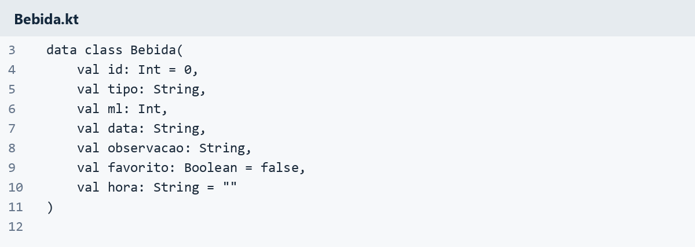
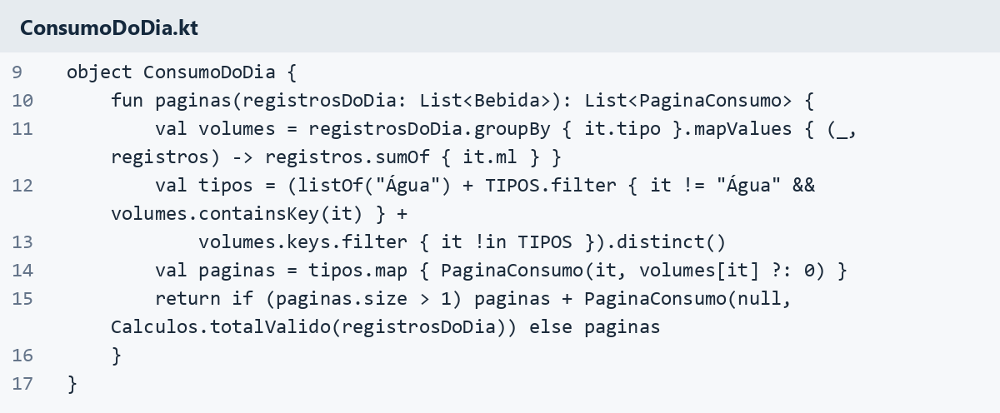
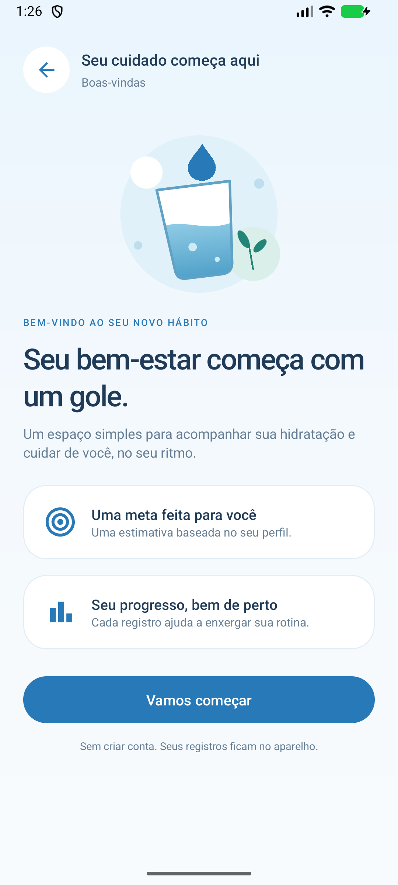
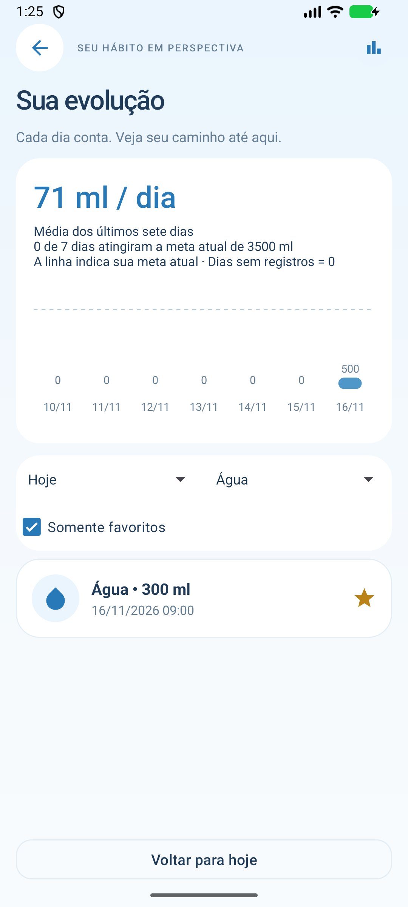

# HIDRATAPP

# HIDRATAPP

# RESUMO

O Hidratapp é um aplicativo Android para registrar bebidas e acompanhar uma meta diária estimada de ingestão de líquidos. O projeto integra conteúdos de desenvolvimento mobile por meio de interfaces XML, lógica em Kotlin, persistência SQLite e preferências locais. A versão atual reúne configuração inicial em quatro etapas, cadastro visual com horário, histórico filtrável, favoritos, estatísticas semanais, registro de sintomas, dicas educativas e lembretes por notificações. Na tela inicial, o indicador circular permite alternar por gesto entre água, outros tipos registrados no dia e o total que participa da meta. Este relatório descreve arquitetura, banco versão 3, regras, decisões de interface e procedimentos de reprodução. A verificação registra compilação do APK, análise estática sem erros, quinze testes unitários e quatorze testes instrumentados aprovados em emulador Android 17. Os cenários abrangem cálculos, migrações, cadastro, edição, preservação de estado, filtros, primeiro acesso, notificações e gestos. Permanecem limitações relacionadas a bases extensas, diferentes aparelhos, acessibilidade, backup e validação clínica das estimativas. O aplicativo se destina à organização pessoal e não constitui instrumento de diagnóstico nem prescrição individual.

# LISTA DE ILUSTRAÇÕES

# SUMÁRIO

## 1 INTRODUÇÃO

O Hidratapp organiza registros diários de bebidas em uma aplicação Android de uso local. O usuário informa seu perfil, registra o que consumiu e acompanha os volumes em uma interface visual. O objetivo acadêmico é demonstrar a integração entre interação, regras de negócio, persistência e verificação em um projeto executável.

Esta atualização descreve o estado atual do aplicativo, incluindo recursos que não existiam na primeira versão do relatório: lembretes agendados, gráficos semanais, filtros, horário de consumo, cadastro por opções visuais e carrossel de bebidas. As imagens e as conclusões anteriores sobre testes de exemplo e divergência de meta foram substituídas pelas evidências atuais.

A revisão de referência do repositório é e6a24ed. A identificação declarada do aplicativo permanece 1.0, e o banco local utiliza a versão 3. A exposição considera comportamentos presentes no código e verificações executadas, sem atribuir à dupla experiências, esforço em horas ou validações não registrados.

Conservamos a apresentação acadêmica do relatório anterior: papel A4, margens superior e esquerda de 3 cm, inferior e direita de 2 cm, corpo em Times New Roman 12 e espaçamento de 1,5. A organização reúne proposta, requisitos, arquitetura, explicação do código, telas, resultados e manual. Os modelos da biblioteca do COTUCA são indicados nas referências como apoio à normalização institucional.

A finalidade é organizar informações pessoais de consumo. A meta é uma regra estimativa do projeto, sem validação clínica individual. Registrar sintomas não permite determinar suas causas. As mensagens e a área de regras explicam esses limites.

## 2 PROPOSTA E OBJETIVOS

Nossa proposta é reunir perfil, registro de bebidas e visualização do consumo em um único aplicativo. A ausência de conta e de servidor próprio reduz as etapas para começar e mantém as operações centrais disponíveis sem conexão com a internet.

O objetivo geral é demonstrar um sistema Android para acompanhar registros e uma meta estimada. Os objetivos específicos são configurar o perfil; calcular a meta de modo consistente; cadastrar, editar, consultar e excluir bebidas; manter favoritos; apresentar estatísticas; registrar sintomas; oferecer conteúdo educativo; e emitir lembretes configuráveis.

A jornada começa com uma abertura ilustrada e uma configuração em quatro etapas. Depois de salvar o perfil, a pessoa acessa o painel, registra água pelos atalhos ou abre o cadastro completo. Os registros alimentam o histórico, o gráfico e as páginas de consumo por categoria.

A interface mantém a identidade da água com azul, branco e verde-água. A organização utiliza um destaque principal por tela, opções tocáveis, cartões arredondados e navegação simples. A intenção é facilitar o registro e a compreensão dos números; não foi conduzido estudo de mercado que comprove superioridade sobre outros produtos.

Permanecem fora do escopo autenticação, sincronização entre aparelhos, integração com relógios e exportação de dados pelo aplicativo. Lembretes locais e estatísticas, antes tratados como propostas futuras, fazem parte da versão atual.

## 3 METODOLOGIA E AMBIENTE TÉCNICO

A atualização foi realizada por leitura das classes, dos layouts e do manifesto, revisão de regras e execução de verificações automatizadas. As imagens da interface foram obtidas em emulador com dados de teste. Os trechos de código foram regenerados a partir dos arquivos atuais, com linhas e resumos criptográficos registrados em capturas.json.

O projeto utiliza Kotlin, layouts XML e Material Components. compileSdk e targetSdk são 37; minSdk é 24. O Gradle utiliza Kotlin DSL e daemon configurado para JDK 17, com compatibilidade do código Java definida como Java 11. A verificação utiliza JUnit, AndroidJUnitRunner e Espresso.

A persistência utiliza SQLiteOpenHelper e SharedPreferences. As APIs SQLite permitem trabalhar com dados estruturados; neste projeto, a conversão entre cursores e modelos é feita diretamente em BancoHelper (Google, s.d.a). Não há Room ou DataStore implementados.

Foram utilizados o Gradle Wrapper do repositório e o emulador Medium_Phone com Android 17. As verificações reuniram assembleDebug, testDebugUnitTest, lintDebug e a suíte instrumentada completa. Os resultados consolidados são apresentados na seção 10.

Os testes confirmam os cenários exercitados nesse ambiente. Não foram realizados estudo com usuários, avaliação clínica, ensaio prolongado de bateria, teste físico em vários fabricantes ou certificação de acessibilidade. A aprovação não demonstra funcionamento irrestrito em todos os aparelhos.

## 4 REQUISITOS DO SISTEMA

O perfil deve receber sexo usado na estimativa, peso, altura, idade, atividade física e condições declaradas opcionalmente. O formulário valida faixas técnicas e permite editar os dados. Essas faixas não comprovam adequação clínica da fórmula para todos os valores aceitos.

O cadastro deve permitir água, suco, refrigerante, café, energético, cerveja, vinho e destilado. O volume deve ser inteiro entre 1 e 5000 ml; data e horário são verificados para evitar instantes futuros. A observação é opcional, e a edição preserva o identificador e o favorito.

O painel deve apresentar Água como primeira página, somar registros de um mesmo tipo no dia e permitir a troca por gesto ou setas. Uma página de total aparece quando há outro tipo registrado. Bebidas alcoólicas permanecem visíveis, mas não aumentam o progresso da meta.

O histórico deve combinar filtros por período, tipo e favorito. O gráfico deve apresentar os últimos sete dias, média incluindo zeros e contagem de dias que atingiram a meta atual. Os filtros do histórico não alteram esse resumo semanal.

Os lembretes devem oferecer intervalo, início e fim no mesmo dia, ativação, teste e acesso às permissões. A aplicação deve reagendar o próximo aviso após eventos previstos no manifesto. As notificações são aproximadas e dependem da autorização e das condições de execução do Android.

Como requisitos de qualidade, o sistema deve preservar registros durante a atualização do banco, confirmar os retornos de gravação, manter informações relevantes após recriação das telas e distinguir dados registrados de orientação profissional.

## 5 ARQUITETURA E ORGANIZAÇÃO DO PROJETO

O sistema utiliza Activities para telas e eventos, modelos para os registros e auxiliares para persistência, regras e apresentação. Existem onze Activities declaradas: abertura, início, perfil, cadastro, detalhes, histórico e estatísticas, sintomas, dicas, Sobre, lembretes e regras e fontes.

Bebida e Sintoma representam os registros. BancoHelper cria o esquema, executa consultas parametrizadas e converte as linhas. Calculos concentra fórmulas e regras de domínio. PerfilRepository lê as preferências e fornece a mesma meta ao início, ao resumo do perfil, às estatísticas e às dicas.

ConsumoDoDia monta páginas agrupadas por categoria. SwipeConsumoLayout reconhece movimento lateral preservando a rolagem vertical. HydrationProgressView desenha o indicador e o preenchimento de água com base no valor de progresso do controle nativo.

Lembretes utiliza AlarmManager, PendingIntent e notificações. LembreteReceiver recebe o alarme e eventos do sistema, publica o aviso quando permitido e agenda o próximo horário. DicasEngine produz mensagens educativas; a Activity correspondente organiza os cartões e permite expandir o texto.

Visual, PageComponents e PaginaSimples compartilham aparência, cabeçalhos, seções e respostas ao toque. WaterIllustrationView desenha a ilustração da abertura e do perfil. A divisão reduz repetição, mas não equivale a uma arquitetura completa com ViewModel e camadas de persistência independentes.

Parte das consultas ainda ocorre diretamente nos fluxos das Activities. Em uma evolução com mais dados, será necessário avaliar acesso assíncrono e observação de estado. Essas alternativas são propostas de manutenção, e não tecnologias já presentes.

## 6 MODELO DE DADOS E PERSISTÊNCIA

A tabela bebidas possui id, tipo, ml, data, hora, observacao e favorito. O identificador é autoincrementável, o volume é inteiro e favorito é representado por 0 ou 1. Data e hora são strings nos padrões dd/MM/yyyy e HH:mm.

A tabela sintomas mantém id, data, sintomas, nivel_sede e observacao. Os itens selecionados são unidos em texto. As tabelas não possuem chave estrangeira entre si; a associação de consultas ocorre pela data.

O banco hidrata.db utiliza a versão 3. Para instalações anteriores à versão 2, onUpgrade cria sintomas. Para versões anteriores à 3, adiciona hora com valor vazio. Registros antigos continuam disponíveis sem inventar um horário que não foi informado.

O histórico de bebidas é ordenado pelos componentes de ano, mês e dia da data, seguidos por horário e identificador. Isso organiza o consumo cronologicamente mesmo com cadastros retroativos. Registros anteriores sem horário conservam essa informação como desconhecida.

SharedPreferences mantém medidas, idade, sexo, atividade e condições declaradas. Outro conjunto guarda os lembretes. O armazenamento é local, sujeito às regras de backup do Android; não há sincronização própria nem uma camada adicional de criptografia implementada no banco.

Consultas por data e identificador usam parâmetros separados do SQL. Inserções retornam identificador ou falha; alterações e exclusões retornam linhas afetadas. Os fluxos revistos verificam esses resultados antes de confirmar sucesso. Os testes exercitam migrações das versões 1 e 2 até o esquema atual.

## 7 EXPLICAÇÃO DOS BLOCOS DO CÓDIGO

### 7.1 Modelos e meta centralizada

Bebida utiliza propriedades val e o método copy para preservar campos não alterados na edição. O horário vazio mantém compatibilidade com registros antigos. A lista TIPOS organiza a escolha de categorias; TIPOS_ALCOOL concentra a classificação usada no total e nos avisos.

PerfilRepository inclui atividade física em todas as leituras da meta, corrigindo a divergência anterior. O fator é 35 ml/kg, passa a 40 abaixo de 18 anos e a 30 acima de 55. Atividade acrescenta 0, 5, 10 ou 15 ml/kg; o indicador masculino aplica 1,05. Int descarta a fração. Para 70 kg, 30 anos, feminino e esporte moderado, o resultado é 3150 ml; com indicador masculino, 3307 ml. São regras do projeto, não uma prescrição clínica.

### 7.2 Migração cadastro e validação

ALTER TABLE adiciona horário sem remover bebidas. A criação de sintomas permanece condicionada à versão antiga. O ensaio de migração utiliza bancos separados e confirma a preservação de dados, seguida de inclusão, leitura, atualização e exclusão.

O tipo vem de uma seleção visual única e obrigatória. Os atalhos somam volume. Data e horário são interpretados com formato estrito, e instantes futuros são recusados. Inserir deve retornar um identificador positivo; atualizar deve afetar uma linha. O uso de copy mantém favorito e identificador na edição. O IMC converte centímetros em metros; para 70 kg e 175 cm, o resultado aproximado é 22,86. Menores de 20 anos não recebem classificação adulta.

### 7.3 Carrossel lembretes e dicas

A primeira página é Água; outros tipos aparecem quando registrados hoje. Uma última página reúne o total válido, sem álcool. Trocar de página não modifica os dados. O gesto reconhece predominância horizontal e distância mínima, deixando a rolagem vertical disponível. A seleção é preservada ao recriar a Activity; se o tipo desaparecer, o painel retorna para Água.

O alarme anterior é cancelado e o próximo horário é calculado. O receptor trata alarme, reinicialização, atualização do pacote e mudanças de data e fuso. Horários são aproximados e podem atrasar por condições do Android (Google, s.d.b). No Android 13 ou posterior, é necessária a permissão de notificações. Dicas e sintomas permanecem educativos: não diagnosticam causas nem apresentam água como forma de neutralizar álcool.

## 8 INTERFACE E JORNADA DE USO

A abertura e as boas-vindas compartilham uma ilustração nativa de água. A identidade mantém azul, branco e verde-água, títulos claros, cartões e espaços para leitura. A transição da abertura é cancelada se a tela for encerrada.

### 8.1 Configuração do perfil

O perfil passa por sexo usado na fórmula, medidas, atividade física e cuidados opcionais. A etapa e os campos são preservados na recriação. O resumo permite revisar a meta e seguir para o dia. Os coeficientes e as limitações ficam disponíveis na área de regras.

### 8.2 Registro e acompanhamento

O cadastro separa tipo, quantidade, data e horário e observação. O botão de salvar permanece acessível na base. No início, o gesto lateral alterna registros agrupados por tipo; os atalhos rápidos continuam dedicados à água. O texto diferencia participação na meta total e registros alcoólicos fora da meta.

### 8.3 Evolução e lembretes

As estatísticas combinam gráfico, média e filtros. Lembretes agrupam ativação, horários, intervalo, teste e permissões. As demais telas usam os mesmos cabeçalhos e cartões; as dicas permitem expandir ou recolher seu conteúdo.

## 9 DECISÕES TÉCNICAS E LIMITAÇÕES

Componentes nativos e armazenamento local mantêm o projeto próximo dos fundamentos da disciplina. SQLiteOpenHelper permite estudar o esquema e as consultas; SharedPreferences atende às configurações pequenas. A escolha exige manutenção manual de consultas e migrações.

A meta compartilhada evita leituras diferentes de atividade física. O total soma integralmente volumes de bebidas sem álcool: é uma definição do aplicativo, e não uma equivalência nutricional entre categorias. As páginas por tipo deixam mais claro o que cada número representa.

Datas e horários em texto preservam o modelo anterior, mas exigem interpretação e ordenação explícitas. Uma representação temporal estruturada poderá simplificar consultas. O projeto não separa instante de inclusão e instante de consumo. A sequência alcoólica não mede doses, teor ou intervalo, e o diálogo de inclusão consulta hoje, mesmo em um cadastro retroativo; a edição não repete esse diálogo.

Consultas ainda ocorrem em fluxos de Activities. Não foram realizados ensaios com bases extensas, medições de tempo, memória e bateria, nem validação de virada do dia com a tela continuamente aberta. O gráfico usa a meta atual em todos os sete dias, sem guardar metas históricas por data.

A verificação em Android 17 não substitui testes físicos, leitor de tela, fontes ampliadas e diferentes fabricantes. Backup, restauração em outro aparelho e atrasos prolongados de notificação precisam de avaliação adicional. A análise estática não demonstra proteção integral dos dados pessoais.

A fórmula e as mensagens não têm validação clínica individual. As referências educativas contextualizam o tema, mas não validam seus coeficientes. O aplicativo comunica que sintomas podem ter várias causas e orientações profissionais devem ser respeitadas (CDC, 2026; NHS, s.d.).

## 10 VERIFICAÇÃO E RESULTADOS

A revisão e6a24ed foi compilada em depuração. assembleDebug terminou com BUILD SUCCESSFUL e lintDebug não registrou erros. O projeto possui avisos de análise estática; o resultado não significa ausência de todos os problemas potenciais.

A execução consolidada registra 15 testes unitários e 14 instrumentados aprovados no emulador Medium_Phone com Android 17. Os antigos testes de exemplo foram substituídos. O quadro resume as suítes atuais.

| Suíte | Testes | Resultado |
|---|---|---|
| CalculosTest | 10 | Aprovados |
| ConsumoDoDiaTest | 5 | Aprovados |
| BancoMigrationTest | 3 | Aprovados |
| FluxosTest | 10 | Aprovados |
| NotificacaoTest | 1 | Aprovado |
| Total | 29 | Sem falhas |

As regras unitárias abrangem meta, IMC, sequência de álcool, soma válida, horários de lembretes e páginas de consumo. Os testes de banco verificam migrações das versões 1 e 2 e operações CRUD. Os fluxos cobrem primeiro acesso, perfil, cadastro, edição, favorito preservado, filtros, Desfazer, coerência de meta, gestos, setas e recriação.

NotificacaoTest verifica a publicação de uma notificação pelo serviço do Android. Não comprova pontualidade em repouso prolongado. Não foram medidos cobertura percentual de código, desempenho ou eficácia clínica. As capturas utilizam dados de teste removidos ao final dos cenários.

## 11 MANUAL DE EXECUÇÃO E USO

Abra no Android Studio a pasta que contém settings.gradle.kts. Sincronize o Gradle e disponibilize JDK 17 e SDK 37. Para uso, utilize um emulador ou aparelho com API 24 ou superior. A resolução das dependências pode exigir internet no ambiente de desenvolvimento.

No Windows, execute .\gradlew.bat :app:assembleDebug :app:testDebugUnitTest :app:lintDebug --console=plain. O APK é gerado em app/build/outputs/apk/debug/app-debug.apk. O relatório unitário fica em app/build/reports/tests/testDebugUnitTest/index.html, e o de lint em app/build/reports/lint-results-debug.html.

Com um emulador de teste conectado, utilize .\gradlew.bat :app:connectedDebugAndroidTest. A alternativa usada na consolidação instala os APKs principal e de teste e executa am instrument com AndroidJUnitRunner. O registro está em app/build/qa/validacao_documentacao.txt.

No primeiro acesso, toque em Vamos começar e percorra as quatro etapas. Informe medidas válidas, escolha a atividade e marque cuidados apenas se desejar. Confira o resumo e toque em Ir para meu dia. O perfil pode ser editado depois pela navegação inferior.

No início, os atalhos +200, +300 e +500 ml registram água imediatamente, com Desfazer por seis segundos. O botão principal abre o cadastro completo. Escolha a categoria, toque no número ou some volume pelos atalhos, confira data e horário e salve. A observação não é obrigatória.

### 11.1 Consulta lembretes e informações

Deslize horizontalmente no círculo ou use as setas para mudar de bebida. A primeira página mostra Água; outros tipos aparecem quando registrados hoje. Havendo outros tipos, a última página mostra o total que participa da meta. Álcool permanece indicado como Fora da meta. Trocar de página não altera dados.

Em Evolução, consulte os sete dias e combine filtros do histórico. Toque em um item para ver detalhes, marcar favorito, editar ou excluir após confirmação. A edição mantém identificador e favorito. Os filtros não modificam o resumo semanal.

Em Lembretes, escolha início, fim e intervalo e salve. Autorize notificações quando solicitado. Use o envio de teste e as permissões para verificar a habilitação. O período deve começar e terminar no mesmo dia. Os horários são aproximados; forçar a parada suspende o trabalho até reabrir o aplicativo.

Em sintomas, selecione os itens percebidos, informe sede e observação se desejar e salve. O histórico permite excluir relatos. Em dicas, use Ler dica para expandir e Recolher para voltar à apresentação resumida. As mensagens não identificam a causa de sintomas.

Regras e fontes estão acessíveis por No seu ritmo e pela tela Sobre. O aplicativo não tem conta, sincronização própria nem exportação do histórico. A recuperação por backup depende das configurações do Android e não foi validada nesta revisão.

## 12 RELATÓRIO TÉCNICO DE AVALIAÇÃO

O objeto avaliado é o Hidratapp 1.0, com banco SQLite 3 e revisão identificada neste relatório. O conjunto integra onze Activities, persistência, cálculo compartilhado, componentes visuais, gráfico, registro de sintomas e lembretes locais.

As principais correções em relação ao documento anterior são a unificação da meta com esporte, a revisão dos textos de saúde, a verificação dos retornos de gravação, a preservação de estado e a migração com horário. A ausência de notificações e a existência de apenas um teste aritmético deixaram de descrever o projeto.

A evolução visual reorganizou abertura, configuração e menus. O cadastro utiliza escolhas por categoria e volume destacado; o painel permite percorrer registros agrupados por bebida. O gráfico e os filtros ampliam a consulta. Os lembretes possuem configuração própria e teste de publicação.

A avaliação reúne 29 testes aprovados e inspeção de imagens da execução. Isso sustenta a demonstração dos cenários exercitados, sem constituir certificação de qualidade, segurança ou adequação clínica. As limitações da seção 9 continuam relevantes antes de uma distribuição pública.

O parecer é favorável à apresentação acadêmica dos recursos implementados e testados. As prioridades futuras são avaliar acessibilidade e mais aparelhos, medir desempenho em bases maiores, revisar backup e proteção dos dados e ampliar as camadas de persistência conforme a escala do sistema.

## 13 CONSIDERAÇÕES FINAIS

O Hidratapp demonstra a integração de interface Android, regras em Kotlin, persistência relacional e testes. A pessoa pode registrar bebidas, acompanhar volumes, consultar histórico, configurar lembretes e manter relatos em uma experiência visual consistente.

A atualização evidencia a necessidade de alinhar documentação e implementação. A meta foi centralizada, o esquema passou a guardar horário, os lembretes foram implementados e os testes de exemplo deram lugar a cenários de domínio e interface. Essas mudanças alteram a demonstração e as conclusões técnicas.

As capturas e os trechos atuais permitem conferir como as classes contribuem para o funcionamento. O resultado consolidado é a aprovação dos testes executados e a compilação do APK, com limites documentados. A próxima evolução deve ampliar aparelhos e configurações avaliados, preservando a finalidade de organização pessoal e os limites das estimativas de saúde.

## REFERÊNCIAS

CENTERS FOR DISEASE CONTROL AND PREVENTION. About Water and Healthier Drinks. 5 mar. 2026. Disponível em: https://www.cdc.gov/healthy-weight-growth/water-healthy-drinks/index.html. Acesso em: 15 nov. 2026.

GOOGLE. Save data using SQLite. Android Developers, s.d.a. Disponível em: https://developer.android.com/training/data-storage/sqlite. Acesso em: 15 nov. 2026.

GOOGLE. Schedule alarms. Android Developers, s.d.b. Disponível em: https://developer.android.com/develop/background-work/services/alarms. Acesso em: 15 nov. 2026.

GOOGLE. Notification runtime permission. Android Developers, s.d.c. Disponível em: https://developer.android.com/develop/ui/compose/notifications/notification-permission. Acesso em: 15 nov. 2026.

HIDRATAPP. Código-fonte do aplicativo. Versão 1.0, revisão e6a24ed. Curitiba, 2026. Disponível em: https://github.com/CaleffiGuilherme/Hidratapp. Analisado em: 15/11/2026.

HIDRATAPP. Relatórios de testes e análise estática. 2026. Arquivos locais: app/build/test-results/testDebugUnitTest, app/build/qa/validacao_documentacao.txt e app/build/reports/lint-results-debug.xml.

NATIONAL HEALTH SERVICE. Water drinks and hydration. NHS, s.d. Disponível em: https://www.nhs.uk/live-well/eat-well/food-guidelines-and-food-labels/water-drinks-nutrition/. Acesso em: 15 nov. 2026.

UNIVERSIDADE ESTADUAL DE CAMPINAS. Colégio Técnico de Campinas. Normas e modelos. Biblioteca do COTUCA, s.d. Disponível em: https://www.cotuca.unicamp.br/biblioteca/normas-e-modelos/. Acesso em: 15 nov. 2026.

## APÊNDICE A ROTEIRO DE DEMONSTRAÇÃO

Apresentar a abertura, percorrer as quatro etapas e cadastrar 70 kg, 175 cm, 30 anos, feminino e esporte moderado. Conferir 3150 ml no resumo. O teste correspondente verifica salvamento e exibição da meta.

Escolher Café, somar 200 e 300 ml e conferir 500 ml. Salvar data e horário válidos, favoritar e editar. Demonstrar preservação do identificador e do favorito. Há testes para seleção, validação, soma e recriação.

Registrar água e outra bebida hoje. Deslizar no círculo, usar as setas e mostrar o total. Conferir a rolagem vertical e a seleção após recriar a tela. Esses comportamentos são exercitados pelo teste de gestos.

Combinar filtros, abrir detalhes e consultar o gráfico. Salvar um período de lembretes, autorizar notificações e enviar um teste. Distinguir publicação imediata de uma verificação prolongada de pontualidade.

Expandir uma dica, registrar um sintoma e abrir regras e fontes. Explicar a finalidade de organização e o caráter estimativo da fórmula, sem tratar números ou mensagens como diagnóstico.

Planejar aparelhos físicos, versões Android adicionais, leitor de tela, fonte ampliada, bases extensas, restauração de backup e virada do dia com a tela aberta. Esses ensaios não foram concluídos e não devem ser apresentados como aprovados.
